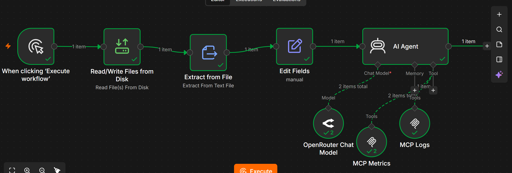
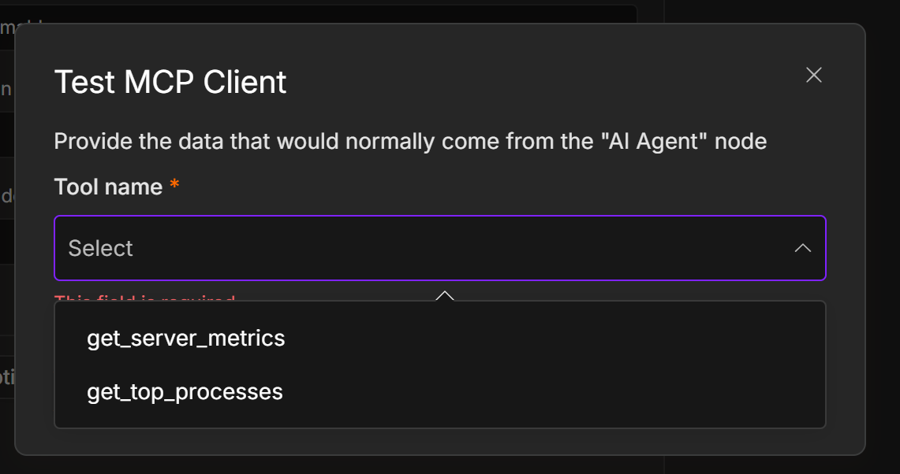
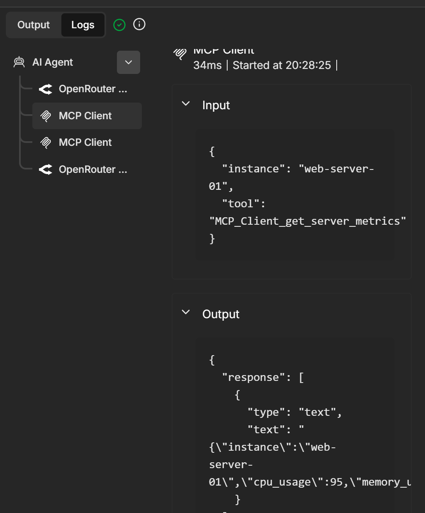
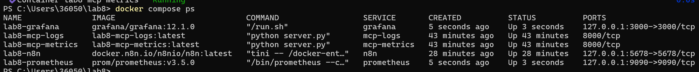
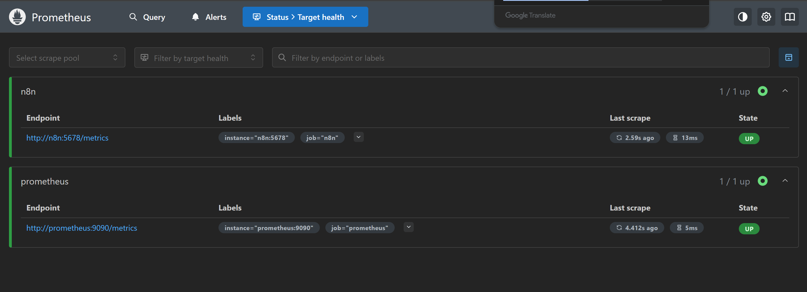
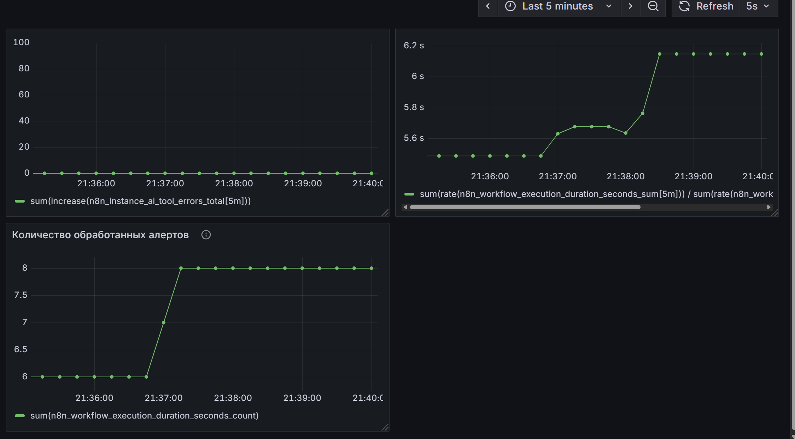
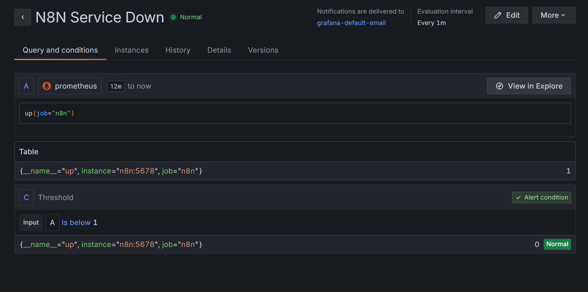

# Лабораторная работа №7 — AI-автоматизация DevOps-процессов

## 1. Реализация workflow в n8n

Самым первым делом мы закинули всю лабу в ИИ и при этом так сказано в лабе, что очень радует! 

Далее уже вместе начали выполнять лабораторную. 

Сперва мы развернули n8n через Docker compose и созадли workflow

Были созданы следующие компоненты 

1. Manual Trigger — ручной запуск автоматизации
2. Read/Write Files from Disk — чтение файла с инструкциями skill
3. Extract From File — преобразование содержимого skill в текст
4. Edit Fields — формирование тестового алерта
5. AI Agent — анализ полученной информации
6. OpenRouter Chat Model — языковая модель, используемая агентом
7. MCP Client Tool — взаимодействие с диагностическими MCP-серверами

Ручной запуск workflow позволил проверить каждый компонент без подключения реальной системы мониторинга

### Итоговая схема workflow



## 2. Создание MCP-серверов

Далее дла получения доп информации об инцидентах были разработаны два MCP-сервера на Python с использованием FastMCP

Каждый сервер работает в отдельном контейнере и предоставляет ии агенту набор инструментов

### MCP Metrics

Первый сервер отвечает за получение информации о состоянии оборудования. Реализованы инструменты

- `get_server_metrics` — получение загрузки CPU, оперативной памяти и состояния сервера.
- `get_top_processes` — получение списка процессов с наибольшим потреблением CPU.

### MCP Logs

Второй сервер предназначен для анализа журналов приложения.Реализованы инструменты

- `get_service_logs` — получение записей журнала сервера.
- `search_errors` — поиск сообщений об ошибках.

В сумме были получены 4 инстурмента для анализа метрик 

### Доступные MCP-инструмент



После подключения серверов мы проверили их работу через n8n. ИИ-агент смог самостоятельно вызывать необходимые инструменты и получать диагностические данные.

### Проверка выполнения MCP



## 3. Настройка AI-агента и Skills

Далее мы покдлючили модеель OpenRouter и создали skill `alert-triage.md`, содержащий правила и последовательность диагностики инцидентов

При обработке алерта ии-агент выполняет следующие действия

1. Определяет сервер и тип проблемы
2. Получает метрики CPU и RAM
3. Анализирует наиболее нагруженные процессы
4. Запрашивает журналы приложения
5. Ищет сообщения об ошибках
6. Сопоставляет полученную информацию и формирует рекомендации

В skill также предусмотрены ограничения безопасности: агент не должен придумывать диагностические данные, автоматически перезапускать сервисы или изменять инфраструктуру

## 4. Контейнеризация системы

Для запуска компонентов был подготовлен `docker-compose.yml`

В Docker Compose развёрнуты пять сервисов

| Сервис | Назначение |
|---|---|
| n8n | Автоматизация обработки алертов |
| MCP Metrics | Получение метрик сервера |
| MCP Logs | Анализ журналов приложения |
| Prometheus | Сбор метрик системы |
| Grafana | Визуализация и алертинг |

### Запущенные контейнеры



## 5. Тестирование системы

Далее мы использовали тестовый алерт для проверки нашего решения

| Параметр | Значение |
|---|---|
| Название | HighCPUUsage |
| Критичность | critical |
| Сервер | web-server-01 |
| Загрузка CPU | 95% |
| Порог срабатывания | 90% |

После запуска workflow ии-агент обратился к обоим MCP-серверам и получил дополнительные сведения

В ходе диагностики были выявлены

- Загрузка CPU сервера — 95%
- Использование оперативной памяти — 72%
- Процесс `python`, потребляющий 83% CPU
- Сообщения об ошибках, связанных с продолжительным выполнением фоновой задачи

На основании этих данных агент определил, что вероятной причиной высокой загрузки процессора является тяжелая фоновая задача и сформировал рекомендации по проверке процесса, анализу выполняемой задачи и возможной оптимизации приложения.

**Тестирование подтвердило работоспособность взаимодействия n8n, AI-агента и двух MCP-серверов.**

## 6. Мониторинг Prometheus и Grafana

Для контроля работы автоматизации мы развернули Prometheus и Grafana.

### Prometheus

Prometheus настроен на сбор собственных метрик и метрик n8n с интервалом 15 секунд

После настройки мы проверили доступность сервисов через страницу Targets. Оба задания — `prometheus` и `n8n` — находились в состоянии `UP`.



### Grafana

В Grafana был создан дашборд DevOps Alert Assistant Monitoring

Для визуализации выбраны три показателя

1. Количество выполнений workflow — позволяет отслеживать активность автоматизации
2. Среднее время выполнения — показывает продолжительность обработки запросов
3. Ошибки вызова AI-инструментов — помогает выявлять проблемы взаимодействия с диагностическими инструментами

Во время тестирования было зафиксировано восемь выполнений workflow. Среднее время обработки составляло около 6 секунд, а количество зарегистрированных ошибок AI-инструментов за наблюдаемый период было равно нулю.

### Итоговый дашборд Grafana



### Обоснование алертов

Также мы определили три возможных алерта

| Алерт | Условие | Причина выбора |
|---|---|---|
| N8N Service Down | Недоступность n8n более 1 минуты | Позволяет своевременно обнаружить остановку автоматизации |
| Slow Alert Processing | Среднее время выполнения более 15 секунд в течение 5 минут | Позволяет выявить задержки обработки инцидентов |
| MCP Tool Errors | Более 0 ошибок за 5 минут | Позволяет обнаружить проблемы с диагностическими инструментами |

Таже настроили реально правило в grafana проверяющее доступность платформы




## 7. Структура проекта

```text
lab_8/
├── docker-compose.yml
├── README.md
├── mcp/
│   ├── metrics/
│   │   ├── Dockerfile
│   │   ├── requirements.txt
│   │   └── server.py
│   └── logs/
│       ├── Dockerfile
│       ├── requirements.txt
│       └── server.py
├── n8n/
│   └── devops-alert-assistant.json
├── skills/
│   └── alert-triage.md
├── monitoring/
│   └── prometheus.yml
└── screenshots/
    └── ...
```

## 8. Вывод

Данная лабораторная работа позволила почувствовать себя реальным B2B SaaS AI фрилансером. Мы сами разработали автоматического помощника. Сами выбрали какую именно проблему он будет решать. В итоге мы получили не просто выполненную лабораторную, а рабочий прототип, который при дальнейшем развитии вполне можно адаптировать под реальные задачи компании
